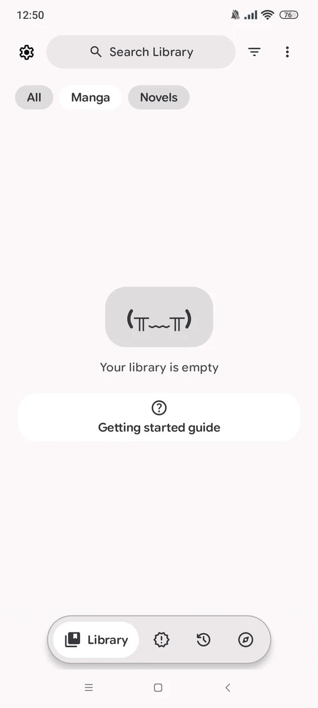
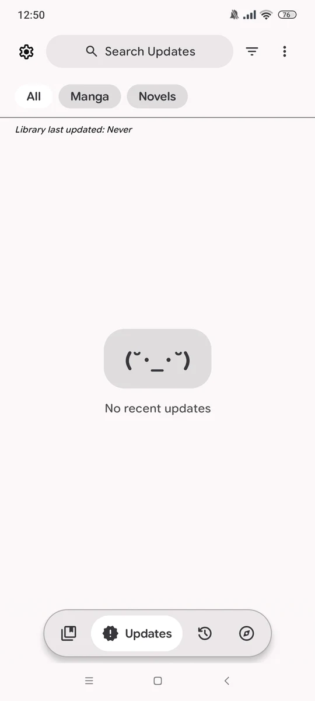
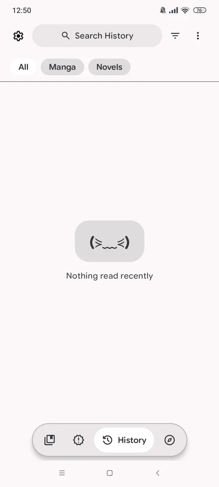
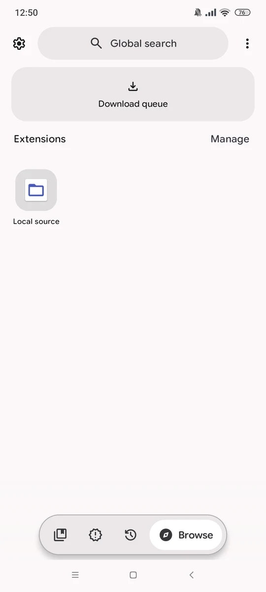
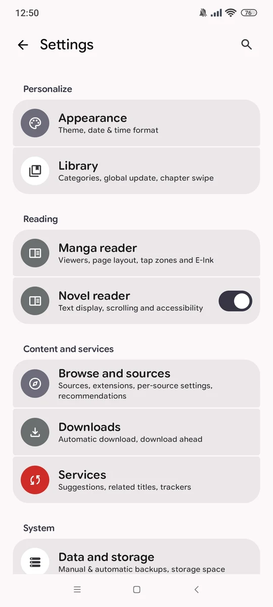
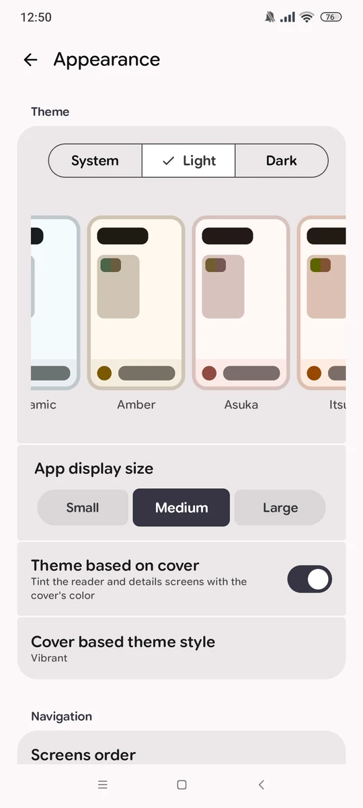

# Raito

### One quiet library for manga and light novels

A free and open source reader for Android. Manga and light novels live side by side in a single library, wrapped in a calm, floating, low-chrome interface.

 

*Requires Android 8.0 or higher.*

<table>
  <tr>
    <td align="center"> Library</td>
    <td align="center"> Updates</td>
    <td align="center"> History</td>
  </tr>
  <tr>
    <td align="center"> Browse</td>
    <td align="center"> Settings</td>
    <td align="center"> Appearance</td>
  </tr>
</table>

## About

Raito is a manga and light-novel reader for Android in the Tachiyomi / Mihon lineage, with an identity of its own. It treats both content types as first-class: one library, one set of screens, one interaction language. Content type shows up as quiet metadata (a filter chip, a small badge), never as a differently styled app.

The look is deliberately **quiet, dense and deliberate**: tonal fills instead of outlines, one consistent side margin, a floating navigation bar that content scrolls beneath, and a search pill at the top of every tab. Reading sessions stay calm, and the library stays easy to scan.

Raito is a fork of **Reikai**, the original app, which is itself built on Mihon. Its visual direction takes its inspiration from [**DropSauce**](https://github.com/HuzaifaKhalid1311/DropSauce).

## What's new

Highlights of what Raito adds on top of Reikai and the Mihon base. The full list is in [CHANGELOG.md](./CHANGELOG.md).

### A redesigned interface
- **Floating navigation bar** with a progressive blur: content scrolls underneath it. A switch in Appearance turns the blur off or brings back the classic bar.
- **Reorderable tabs**: choose the order of Library, Updates, History and Browse under Appearance → Screens order. The app opens on the first one.
- **A centered search pill on every tab header**.
- **Tonal cards, chips and bar** with no outlines, and a single 20 dp side margin across the app.
- **Regrouped settings**: Personalize, Reading, Content and services, System. Appearance is split into Navigation, Language and formats, and Interface.
- **Many themes**, light or dark, plus an optional cover-based theme for the details and reader screens.
- **Three app display sizes**: Small, Medium and Large.

### Manga and novels, together
- **All / Manga / Novels chips** on Library, Updates and History.
- **One switch for novels**: the Novel reader card in Settings shows or hides novels across the whole app.
- **Merged series**: fold the same title from several sources into one entry, with a per-source switcher. Merge and unmerge by hand when titles differ.
- **Category sort order** and bulk delete with undo.

### Library
- **Continue button**: an optional floating button that reopens the series you read last (hidden in incognito).
- **Reading progress on covers**, as a percent or as read and total chapters.
- **Tap a cover to resume reading** instead of opening the details.

### Details, History and Browse
- **Redesigned details header, action row and related slider.**
- **Collapsible long descriptions**, with a switch to always show them in full.
- **Redesigned History cards** with an accent chapter chip and a slim progress bar, plus a Display tab to show or hide the cover, progress and actions.
- **Suggestions in Browse** that load as each source answers, follow the genres you read most, and can hide adult sources and titles.

### Reader
- **Adjustable gap between webtoon pages** (0 to 24 dp, 0 keeps the strip seamless).
- **Open each chapter in its own task** in recent apps.
- **Ask where to save pages** each time.

## Features inherited from the base

Raito builds on Mihon, so the core experience carries over:

- A configurable reader with multiple viewers, reading directions and tap zones.
- Light-novel reading with native or WebView rendering and extension support.
- Tracker support, including MyAnimeList, AniList, Kitsu, MangaUpdates, Shikimori and Bangumi.
- Categories, scheduled library updates, and local or cloud backups.
- Local sources and third-party extensions and repositories.
- Light and dark themes.

## Contributing

Bug reports, ideas and pull requests are welcome. See [CONTRIBUTING.md](./CONTRIBUTING.md) and the [Code of Conduct](./CODE_OF_CONDUCT.md). Raito does not maintain or fix third-party extensions or sources; problems with a specific source are out of scope.

## Credits

- **[Reikai](https://github.com/unseensnick)**: the original app Raito is forked from.
- **[DropSauce](https://github.com/HuzaifaKhalid1311/DropSauce)**: design and inspiration for Raito's interface.
- **[Mihon](https://github.com/mihonapp/mihon)** and the wider **Tachiyomi** community: the base the whole lineage stands on.
- **[Yōkai](https://github.com/null2264/yokai)** and **[TachiyomiJ2K](https://github.com/Jays2Kings/tachiyomiJ2K)**: ancestors of the single-list library and dynamic grouping.
- **[Komikku](https://github.com/komikku-app/komikku)**: the related-titles carousel, adult sources, edit-info editor and auto webtoon mode.
- **[LNReader](https://github.com/LNReader/lnreader)**, **[Tsundoku](https://github.com/tsundoku-otaku/tsundoku)** and **[IReader](https://github.com/IReaderorg/IReader)**: the light-novel plugin and extension ecosystem.

Thanks to everyone who contributed to those projects.

## Disclaimer

The developers of this application are not affiliated with any content provider, and the application hosts zero content.

## License

<pre>
Copyright © 2015 Javier Tomás
Copyright © 2024 Mihon Open Source Project
Copyright © 2026 Raito contributors

Licensed under the Apache License, Version 2.0 (the "License");
you may not use this file except in compliance with the License.
You may obtain a copy of the License at

http://www.apache.org/licenses/LICENSE-2.0

Unless required by applicable law or agreed to in writing, software
distributed under the License is distributed on an "AS IS" BASIS,
WITHOUT WARRANTIES OR CONDITIONS OF ANY KIND, either express or implied.
See the License for the specific language governing permissions and
limitations under the License.
</pre>
